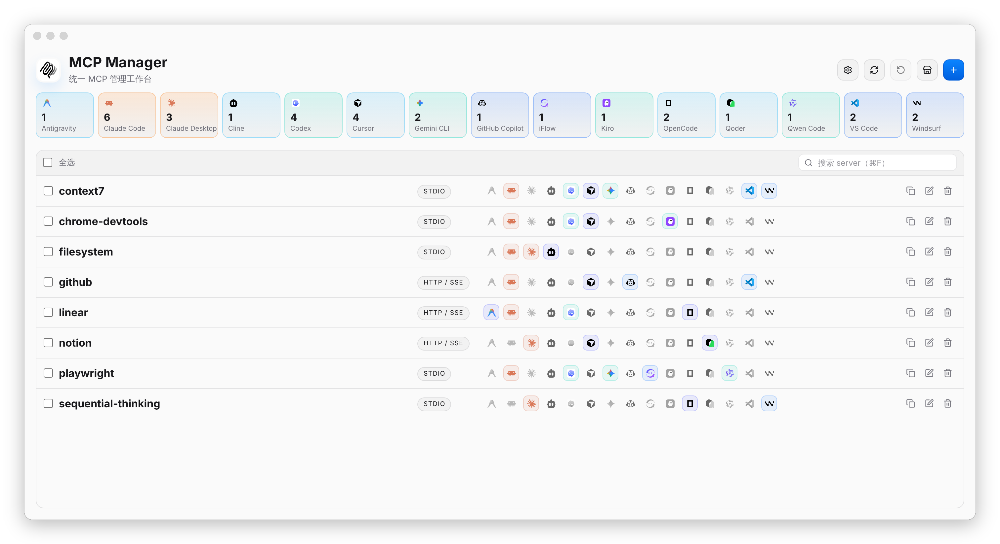
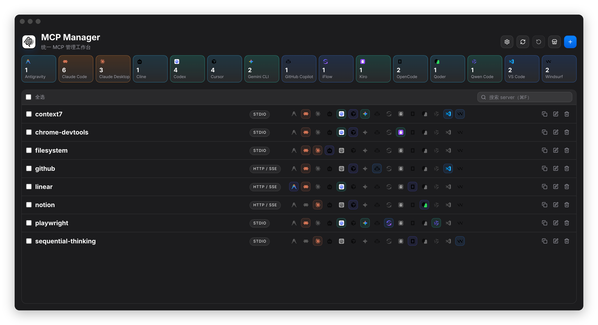

<h1 align="center">
   MCP Manager
</h1>

<p align="center">
  一个跨平台桌面应用，用于管理 Claude Code、Codex、Cursor、VS Code、OpenCode、Gemini CLI 等客户端的 MCP Server 配置。
</p>

<p align="center">
  <a href="https://github.com/xjeway/mcp-manager/stargazers"></a>
  <a href="./LICENSE"></a>
  
  
  
  
</p>

<p align="center">
  <sub><a href="./README.md">English</a> · <b>简体中文</b> · <a href="./docs/readme/README.zh-TW.md">繁體中文</a> · <a href="./docs/readme/README.ja.md">日本語</a> · <a href="./docs/readme/README.ko.md">한국어</a> · <a href="./docs/readme/README.de.md">Deutsch</a> · <a href="./docs/readme/README.fr.md">Français</a> · <a href="./docs/readme/README.es.md">Español</a> · <a href="./docs/readme/README.it.md">Italiano</a> · <a href="./docs/readme/README.pt-BR.md">Português</a> · <a href="./docs/readme/README.ru.md">Русский</a></sub>
</p>

<h3 align="center"><a href="https://github.com/xjeway/mcp-manager/releases/latest"><ins>下载 MCP Manager</ins></a></h3>

## 目录

- [功能特性](#功能特性)
- [下载与安装](#下载与安装)
- [支持的客户端](#支持的客户端)
- [命令行（预览）](#命令行预览)
- [隐私与联网](#隐私与联网)
- [开发](#开发)
- [Star History](#star-history)
- [免责声明](#免责声明)

## 功能特性

- **统一工作台**管理所有 MCP Server，可从客户端已有的配置中导入
- **在线市场**：在 GitHub MCP Registry、官方 MCP Registry 或任何兼容的注册表中搜索 server，几步即可添加
- 支持**表单或原始 JSON** 编辑
- **一次应用到多个客户端**，写入前审查有风险的改动，并自动备份、支持回滚
- 浅色 / 深色主题，界面支持 11 种语言，默认跟随系统语言

<table>
  <tr>
    <td></td>
    <td></td>
  </tr>
</table>

## 下载与安装

从 [最新发布版本](https://github.com/xjeway/mcp-manager/releases/latest) 下载对应平台的安装包：

| 平台 | 安装包 |
| --- | --- |
| macOS | `.dmg`，或 `brew install --cask xjeway/mcp-manager/mcp-manager` |
| Windows | `setup.exe`（x64 / arm64）或 `.msi`（x64） |
| Linux | `.deb`、`.rpm` 或 `.AppImage` |

Apple Silicon 和 ARM 设备请选择 `arm64` / `aarch64`，其他设备选择 `x64` / `x86_64` / `amd64`。

<details>
<summary>macOS 提示应用已损坏或无法打开？</summary>

发布版本暂未经过公证。请先将应用移动到 `/Applications`，然后运行：

```bash
xattr -dr com.apple.quarantine "/Applications/MCP Manager.app"
```

</details>

## 支持的客户端

以下所有客户端均支持**导入**（读取其配置中已有的 MCP Server）和**应用**（将统一配置写回）。

<p>
  <a href="https://docs.anthropic.com/en/docs/claude-code"><kbd> Claude Code</kbd></a> &nbsp;
  <a href="https://claude.ai/download"><kbd> Claude Desktop</kbd></a> &nbsp;
  <a href="https://github.com/openai/codex"><kbd> Codex</kbd></a> &nbsp;
  <a href="https://cursor.com"><kbd> Cursor</kbd></a> &nbsp;
  <a href="https://opencode.ai"><kbd> OpenCode</kbd></a> &nbsp;
  <a href="https://github.com/features/copilot"><kbd> GitHub Copilot</kbd></a> &nbsp;
  <a href="https://github.com/google-gemini/gemini-cli"><kbd> Gemini CLI</kbd></a> &nbsp;
  <a href="https://antigravity.google"><kbd> Antigravity</kbd></a> &nbsp;
  <a href="https://github.com/iflow-ai/iflow-cli"><kbd> iFlow</kbd></a> &nbsp;
  <a href="https://github.com/QwenLM/qwen-code"><kbd> Qwen Code</kbd></a> &nbsp;
  <a href="https://cline.bot"><kbd> Cline</kbd></a> &nbsp;
  <a href="https://windsurf.com"><kbd> Devin Desktop (Windsurf)</kbd></a> &nbsp;
  <a href="https://kiro.dev"><kbd> Kiro</kbd></a> &nbsp;
  <a href="https://qoder.com"><kbd> Qoder</kbd></a> &nbsp;
  <a href="https://kilo.ai"><kbd> Kilo Code</kbd></a> &nbsp;
  <a href="https://factory.ai"><kbd> Factory Droid</kbd></a> &nbsp;
  <a href="https://github.com/MoonshotAI/kimi-cli"><kbd> Kimi CLI</kbd></a> &nbsp;
  <a href="https://zed.dev"><kbd> Zed</kbd></a> &nbsp;
  <a href="https://github.com/mistralai/mistral-vibe"><kbd> Mistral Vibe</kbd></a> &nbsp;
  <a href="https://github.com/NousResearch/hermes-agent"><kbd> Hermes Agent</kbd></a> &nbsp;
  <a href="https://github.com/block/goose"><kbd> Goose</kbd></a> &nbsp;
  <a href="https://ampcode.com"><kbd> Amp</kbd></a> &nbsp;
  <a href="https://code.visualstudio.com"><kbd> VS Code</kbd></a> &nbsp;
</p>

## 命令行（预览）

`mcpmgr` 与桌面应用共用同一份 server 列表，在任一端的修改另一端都能看到。

```bash
npx @mcpmgr/cli list                      # 或：npm i -g @mcpmgr/cli / brew install xjeway/mcp-manager/mcpmgr

mcpmgr add context7 -- npx -y @upstash/context7-mcp@latest
mcpmgr add linear --url https://mcp.linear.app/mcp -a cursor,claude-code
mcpmgr remove context7 -a codex
mcpmgr rollback
```

在终端中，`add` 会分步引导你选择 server、客户端和作用范围，并在写入前预览每个文件。每一步也都有对应参数（`--yes`、`--dry-run`、`--json` 等）；在 Claude Code、Codex 等 AI 编程工具中运行时，会跳过提问并以该工具的客户端为目标。

## 隐私与联网

MCP Manager 只在检查更新，以及打开在线市场页面时查询 MCP 注册表才会联网（结果缓存 6 小时，断网时仍可使用）。在 **设置 → 在线市场** 中关闭市场，即可完全停止这些请求。

## 开发

需要 Node.js 20+、Rust stable，以及当前平台的 [Tauri 系统依赖](https://tauri.app/start/prerequisites/)。

```bash
make install      # 安装依赖
make tauri-dev    # 启动桌面应用
make test && make check
```

核心逻辑（客户端适配、解析、安全写入）位于 `crates/mcp-manager-core`，由 `src-tauri/` 中的 Tauri 应用和 `crates/mcp-manager-cli/` 中的命令行工具共用。发版流程见 [`docs/releasing.md`](./docs/releasing.md)。

欢迎提交 Issue 和 Pull Request；如果是比较大的改动，请先开一个 issue。修改面向用户的文档时，请同步维护 [`README.md`](./README.md)、[`README.zh-CN.md`](./README.zh-CN.md) 以及 [`docs/readme/`](./docs/readme/)。

## Star History

<a href="https://star-history.com/#xjeway/mcp-manager&Date">
  <picture>
    <source media="(prefers-color-scheme: dark)" srcset="https://api.star-history.com/svg?repos=xjeway/mcp-manager&type=Date&theme=dark" />
    <source media="(prefers-color-scheme: light)" srcset="https://api.star-history.com/svg?repos=xjeway/mcp-manager&type=Date" />
    
  </picture>
</a>

## 免责声明

本项目主要借助 AI 开发，并由维护者人工审阅，仍可能存在错误。MCP Manager 会改写其他工具的配置文件；应用内置了备份与回滚，但请自行备份重要的配置。本软件按“原样”依据 [MIT License](./LICENSE) 提供。
