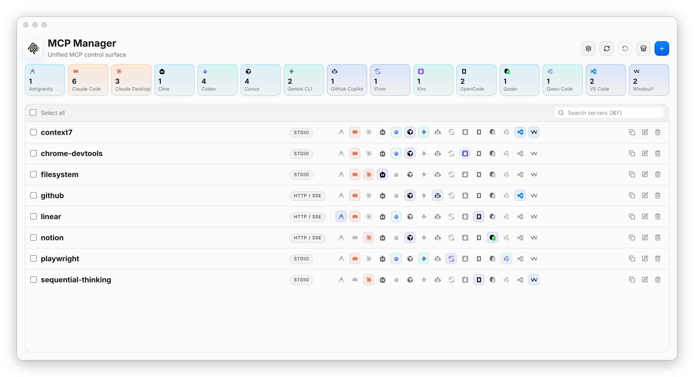
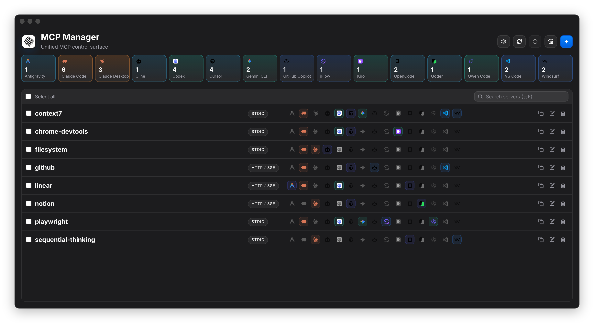

<h1 align="center">
   MCP Manager
</h1>

<p align="center">
  Eine plattformübergreifende Desktop-App zur Verwaltung von MCP-Server-Konfigurationen für Claude Code, Codex, Cursor, VS Code, OpenCode, Gemini CLI und weitere.
</p>

<p align="center">
  <a href="https://github.com/xjeway/mcp-manager/stargazers"></a>
  <a href="../../LICENSE"></a>
  
  
  
  
</p>

<p align="center">
  <sub><a href="../../README.md">English</a> · <a href="../../README.zh-CN.md">简体中文</a> · <a href="./README.zh-TW.md">繁體中文</a> · <a href="./README.ja.md">日本語</a> · <a href="./README.ko.md">한국어</a> · <b>Deutsch</b> · <a href="./README.fr.md">Français</a> · <a href="./README.es.md">Español</a> · <a href="./README.it.md">Italiano</a> · <a href="./README.pt-BR.md">Português</a> · <a href="./README.ru.md">Русский</a></sub>
</p>

<h3 align="center"><a href="https://github.com/xjeway/mcp-manager/releases/latest"><ins>MCP Manager herunterladen</ins></a></h3>

## Inhaltsverzeichnis

- [Funktionen](#funktionen)
- [Installation](#installation)
- [Unterstützte Clients](#unterstützte-clients)
- [Kommandozeile (Vorschau)](#kommandozeile-vorschau)
- [Datenschutz & Netzwerk](#datenschutz--netzwerk)
- [Entwicklung](#entwicklung)
- [Star History](#star-history)
- [Haftungsausschluss](#haftungsausschluss)

## Funktionen

- **Ein Arbeitsbereich** für alle MCP-Server, importiert aus den Konfigurationen, die Ihre Clients bereits haben
- **Online-Marktplatz**: Server in der GitHub MCP Registry, der offiziellen MCP Registry oder einer beliebigen kompatiblen Registry finden und mit wenigen Klicks hinzufügen
- Bearbeitung per **Formular oder Roh-JSON**
- **Auf viele Clients gleichzeitig anwenden**, mit Prüfung riskanter Schreibvorgänge, automatischen Backups und Rollback
- Helles / dunkles Design und eine Oberfläche in 11 Sprachen, die der Systemsprache folgt

<table>
  <tr>
    <td></td>
    <td></td>
  </tr>
</table>

## Installation

Laden Sie das Paket für Ihre Plattform aus dem [neuesten Release](https://github.com/xjeway/mcp-manager/releases/latest) herunter:

| Plattform | Paket |
| --- | --- |
| macOS | `.dmg` oder `brew install --cask xjeway/mcp-manager/mcp-manager` |
| Windows | `setup.exe` (x64 / arm64) oder `.msi` (x64) |
| Linux | `.deb`, `.rpm` oder `.AppImage` |

Wählen Sie `arm64` / `aarch64` für Apple Silicon und ARM-Geräte, sonst `x64` / `x86_64` / `amd64`.

<details>
<summary>macOS meldet, dass die App beschädigt ist oder nicht geöffnet werden kann?</summary>

Release-Builds sind ad-hoc signiert, aber noch nicht von Apple notarisiert. Beim ersten Start:

1. Verschieben Sie die App nach `/Applications`, öffnen Sie sie und schließen Sie die Warnung.
2. Öffnen Sie **Systemeinstellungen → Datenschutz & Sicherheit**, klicken Sie unten auf **Dennoch öffnen** und bestätigen Sie.

Wenn macOS weiterhin meldet, dass die App beschädigt ist (ältere, unsignierte Versionen), führen Sie aus:

```bash
xattr -dr com.apple.quarantine "/Applications/MCP Manager.app"
```

</details>

## Unterstützte Clients

Jeder der folgenden Clients unterstützt sowohl **Import** (vorhandene MCP-Server aus seiner Konfiguration lesen) als auch **Anwenden** (die einheitliche Konfiguration zurückschreiben).

<p>
  <a href="https://docs.anthropic.com/en/docs/claude-code"><kbd> Claude Code</kbd></a> &nbsp;
  <a href="https://claude.ai/download"><kbd> Claude Desktop</kbd></a> &nbsp;
  <a href="https://github.com/openai/codex"><kbd> Codex</kbd></a> &nbsp;
  <a href="https://cursor.com"><kbd> Cursor</kbd></a> &nbsp;
  <a href="https://opencode.ai"><kbd> OpenCode</kbd></a> &nbsp;
  <a href="https://github.com/features/copilot"><kbd> GitHub Copilot</kbd></a> &nbsp;
  <a href="https://github.com/google-gemini/gemini-cli"><kbd> Gemini CLI</kbd></a> &nbsp;
  <a href="https://antigravity.google"><kbd> Antigravity</kbd></a> &nbsp;
  <a href="https://github.com/iflow-ai/iflow-cli"><kbd> iFlow</kbd></a> &nbsp;
  <a href="https://github.com/QwenLM/qwen-code"><kbd> Qwen Code</kbd></a> &nbsp;
  <a href="https://cline.bot"><kbd> Cline</kbd></a> &nbsp;
  <a href="https://windsurf.com"><kbd> Devin Desktop</kbd></a> &nbsp;
  <a href="https://kiro.dev"><kbd> Kiro</kbd></a> &nbsp;
  <a href="https://qoder.com"><kbd> Qoder</kbd></a> &nbsp;
  <a href="https://kilo.ai"><kbd> Kilo Code</kbd></a> &nbsp;
  <a href="https://factory.ai"><kbd> Factory Droid</kbd></a> &nbsp;
  <a href="https://github.com/MoonshotAI/kimi-cli"><kbd> Kimi CLI</kbd></a> &nbsp;
  <a href="https://zed.dev"><kbd> Zed</kbd></a> &nbsp;
  <a href="https://github.com/mistralai/mistral-vibe"><kbd> Mistral Vibe</kbd></a> &nbsp;
  <a href="https://github.com/NousResearch/hermes-agent"><kbd> Hermes Agent</kbd></a> &nbsp;
  <a href="https://github.com/block/goose"><kbd> Goose</kbd></a> &nbsp;
  <a href="https://ampcode.com"><kbd> Amp</kbd></a> &nbsp;
  <a href="https://code.visualstudio.com"><kbd> VS Code</kbd></a> &nbsp;
</p>

## Kommandozeile (Vorschau)

`mcpmgr` teilt sich die Serverliste mit der Desktop-App, sodass Änderungen in einem der beiden auch im anderen erscheinen.

```bash
npx @mcpmgr/cli list                      # oder: npm i -g @mcpmgr/cli / brew install xjeway/mcp-manager/mcpmgr

mcpmgr add context7 -- npx -y @upstash/context7-mcp@latest
mcpmgr add linear --url https://mcp.linear.app/mcp -a cursor,claude-code
mcpmgr remove context7 -a codex
mcpmgr rollback
```

Im Terminal führt `add` Sie durch Server, Clients und Geltungsbereich und zeigt vor dem Schreiben eine Vorschau jeder Datei. Jeder Schritt hat auch ein Flag (`--yes`, `--dry-run`, `--json`, …); innerhalb eines KI-Coding-Agenten wie Claude Code oder Codex überspringt es die Abfragen und zielt auf den Client dieses Agenten.

## Datenschutz & Netzwerk

MCP Manager geht nur online, um nach Updates zu suchen und, solange die Marktplatz-Seite geöffnet ist, um MCP-Registries abzufragen (6 Stunden zwischengespeichert, offline nutzbar). Deaktivieren Sie den Marktplatz unter **Einstellungen → Online-Marktplatz**, um diese Anfragen vollständig zu unterbinden.

## Entwicklung

Erfordert Node.js 20+, Rust stable und die [Tauri-Voraussetzungen](https://tauri.app/start/prerequisites/) für Ihre Plattform.

```bash
make install      # Abhängigkeiten installieren
make tauri-dev    # Desktop-App starten
make test && make check
```

Die Kernlogik (Client-Adapter, Parsing, sichere Schreibvorgänge) liegt in `crates/mcp-manager-core` und wird von der Tauri-App in `src-tauri/` und der CLI in `crates/mcp-manager-cli/` gemeinsam genutzt. Releases sind in [`docs/releasing.md`](../../docs/releasing.md) beschrieben.

Issues und Pull Requests sind willkommen; bei größeren Änderungen eröffnen Sie bitte zuerst ein Issue. Halten Sie beim Ändern nutzerseitiger Dokumentation [`README.md`](../../README.md), [`README.zh-CN.md`](../../README.zh-CN.md) und [`docs/readme/`](./) synchron.

## Star History

<a href="https://star-history.com/#xjeway/mcp-manager&Date">
  <picture>
    <source media="(prefers-color-scheme: dark)" srcset="https://api.star-history.com/svg?repos=xjeway/mcp-manager&type=Date&theme=dark" />
    <source media="(prefers-color-scheme: light)" srcset="https://api.star-history.com/svg?repos=xjeway/mcp-manager&type=Date" />
    
  </picture>
</a>

## Haftungsausschluss

Dieses Projekt wird überwiegend mit KI-Unterstützung entwickelt und von einem menschlichen Maintainer geprüft, kann daher aber dennoch Fehler enthalten. MCP Manager überschreibt die Konfigurationsdateien anderer Tools; Backups und Rollback sind integriert, dennoch sollten Sie wichtige Konfigurationen selbst sichern. Bereitgestellt „wie besehen“ unter der [MIT License](../../LICENSE).
